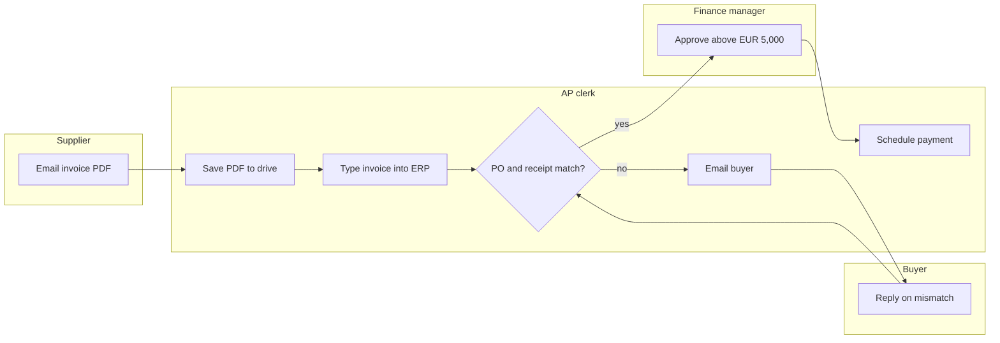

# Example: supplier invoice processing (fictional)

Example Co. is a fictional 300-person distributor. All names and figures are invented to show what map-workflow produces.

## Boundary

- Trigger: a supplier emails an invoice PDF to the accounts payable inbox.
- End result: the invoice is paid on its due date and recorded in the ERP.
- Owner: Accounts payable lead.
- Volume: 1,200 invoices a month.

## Steps

| # | Role | Action | Tool | Minutes | Wait after | Occurs | Friction |
|---|---|---|---|---|---|---|---|
| 1 | Supplier | Emails invoice PDF | Email | 0 | 1 day | every invoice | queue |
| 2 | AP clerk | Downloads PDF and saves it to the shared drive | Email, shared drive | 2 | none | every invoice | copy and paste |
| 3 | AP clerk | Types header and invoice lines into the ERP | ERP | 6 | none | every invoice | manual re-entry |
| 4 | AP clerk | Matches invoice to purchase order and goods receipt | ERP | 4 | none | every invoice | rework in 15% |
| 5 | AP clerk, buyer | Emails buyer about a mismatch; buyer replies | Email | 4 + 5 | 3 days | 15% (180 a month) | handoff, wait, rework |
| 6 | Finance manager | Approves invoices above EUR 5,000 | ERP | 2 | 2 days | 20% (240 a month) | approval, wait |
| 7 | AP clerk | Schedules payment | Banking portal | 1 | none | every invoice | manual re-entry |

## Hands-on time per month

- Step 2: 1,200 × 2 = 2,400 min
- Step 3: 1,200 × 6 = 7,200 min
- Step 4: 1,200 × 4 = 4,800 min
- Step 5: 180 × 9 = 1,620 min
- Step 6: 240 × 2 = 480 min
- Step 7: 1,200 × 1 = 1,200 min
- Total: 17,700 min = 295 hours a month

## Open questions

- How many invoices arrive as scanned images rather than digital PDFs? (AP lead)
- Are goods receipts recorded on the day of delivery? (Warehouse lead)
